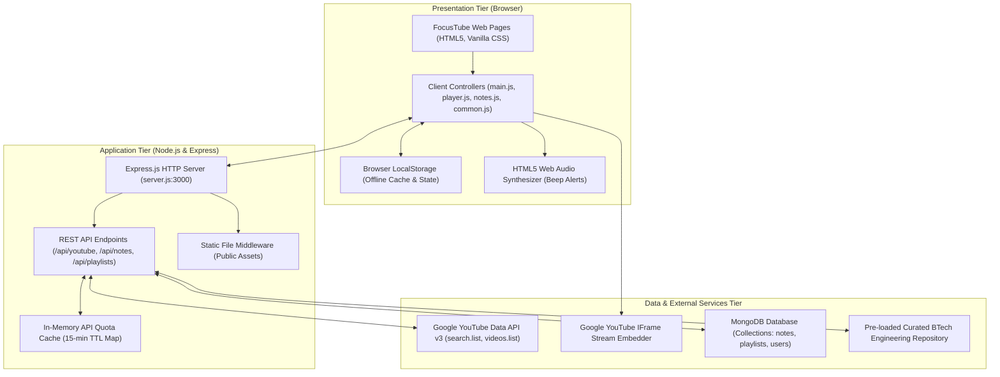
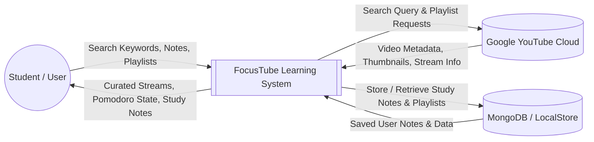
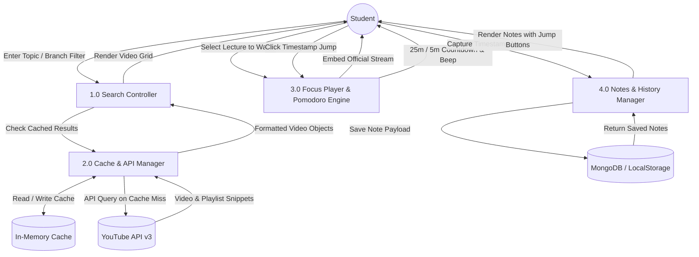
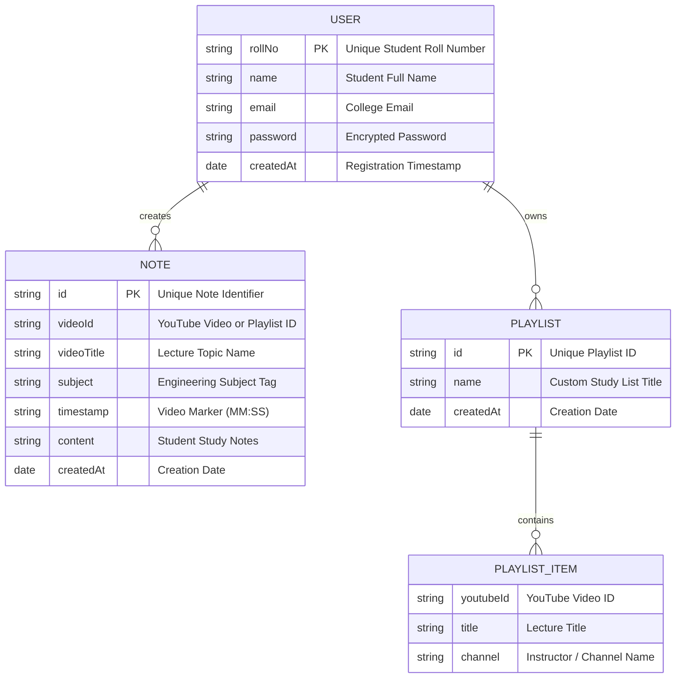

# FocusTube - Project Report & Viva Presentation Guide
**Bachelor of Technology (B.Tech) - Computer Science & Engineering**  
**Course:** Full Stack Web Development (Mini-Project)  
**Academic Year:** 2026–2027  

---

## 📑 TABLE OF CONTENTS
1. [Abstract](#1-abstract)
2. [Introduction & Problem Statement](#2-introduction--problem-statement)
3. [Literature Survey & Comparative Study](#3-literature-survey--comparative-study)
4. [Software Requirements Specification (SRS)](#4-software-requirements-specification-srs)
5. [System Architecture & Design Diagrams (DFD & ER)](#5-system-architecture--design-diagrams)
6. [Implementation Details & Key Algorithms](#6-implementation-details--key-algorithms)
7. [Testing & Verification Results](#7-testing--verification-results)
8. [5-Minute Live Viva Presentation Script](#8-5-minute-live-viva-presentation-script)
9. [Top 10 Viva Questions & Model Answers](#9-top-10-viva-questions--model-answers)
10. [Conclusion & Future Scope](#10-conclusion--future-scope)

---

## 1. Abstract
The rapid digitization of engineering education has positioned YouTube as one of the world's most accessible repositories of technical lectures, ranging from NPTEL and MIT OpenCourseWare to specialized GATE preparation channels. However, commercial video platforms are fundamentally engineered for entertainment and user engagement maximization rather than focused academic retention. Recommended video sidebars, autoplay loops, algorithmic entertainment shorts, and comment threads severely undermine students' deep-work capabilities.

**FocusTube** is a specialized, distraction-free educational web application engineered specifically for Indian undergraduate engineering students across Computer Science, AI/ML, Electronics, Electrical, Mechanical, Civil, and Basic Sciences. The system integrates the official **YouTube Data API v3** and **YouTube IFrame Player API** behind a secure Node.js/Express backend proxy. It embeds focused study tools directly into the learning workflow, including a **Pomodoro Study Timer** with Web Audio synthesizer alerts, an **interactive timestamped note-taking engine** with one-click video seeking, personal study playlist curation, and an offline-first hybrid storage architecture bridging browser `localStorage` with MongoDB.

---

## 2. Introduction & Problem Statement

### 2.1 The Digital Distraction Problem in Engineering Education
Undergraduate engineering courses (such as Data Structures, Operating Systems, DBMS, Signals & Systems, and Thermodynamics) require sustained, high-focus cognitive effort. When students study on YouTube:
* **The "Rabbit Hole" Phenomenon:** 70% of YouTube watch time is driven by recommendation algorithms designed to keep viewers watching non-educational content.
* **Context Switching:** Toggling between video playback, external notepad applications, and phone timers creates severe cognitive fragmentation.
* **Lack of Discipline Structure:** Students lack a structured engineering taxonomy that categorizes content by core university branches and GATE syllabi.

### 2.2 The FocusTube Solution
FocusTube provides a clean, distraction-free portal:
1. **Isolated Focus Player:** Loads official lecture video streams inside a dedicated player window, completely eliminating recommendation sidebars and user comments.
2. **Integrated Study Clock:** Implements the scientifically backed Pomodoro Technique (25 minutes study, 5 minutes rest) with audio alerts and browser tab time tracking.
3. **Interactive Timestamp Bookmarking:** Allows students to jot down formulas or theorems and jump directly to that exact second in the lecture with a single click.
4. **Dual Data Architecture:** Operates with live YouTube Data API v3 searching while maintaining a high-fidelity offline engineering courseware repository for zero-downtime reliability during network or quota constraints.

---

## 3. Literature Survey & Comparative Study

| Feature / Criteria | Standard YouTube | Coursera / Udemy | FocusTube (This Project) |
| :--- | :--- | :--- | :--- |
| **Cost** | Free with Ads | Paid Subscriptions | **100% Free & Open Source** |
| **Distraction-Free Mode** | ❌ High Distraction (Sidebars, Shorts, Comments) | ✅ Distraction-Free | **✅ Complete Distraction Elimination** |
| **Indian Engineering Curriculum Alignment** | ⚠️ Unorganized Search Results | ❌ Generic Global Curriculum | **✅ Tailored (CSE, ECE, EEE, Mech, Civil, GATE)** |
| **Integrated Pomodoro Timer** | ❌ None | ❌ None | **✅ Built-in 25/5 Timer with Audio Alerts** |
| **Interactive Timestamp Note-Taking**| ⚠️ Comments section only | ⚠️ Basic text notes | **✅ Clickable Video Seeking (`seekTo`) + `.txt` Export** |
| **Offline Course Fallback** | ❌ Requires Internet | ⚠️ Mobile App Only | **✅ Seamless LocalStorage & Sample Fallback** |

---

## 4. Software Requirements Specification (SRS)

### 4.1 Functional Requirements (FR)
* **FR-1 (Educational Search):** The system shall allow users to search for educational lectures and playlists across engineering disciplines using the YouTube Data API v3.
* **FR-2 (Category Filtering):** The system shall provide one-click branch filters (CSE, AI/ML, ECE, EEE, Mechanical, Civil, Mathematics, GATE) and core subject chips (DSA, DBMS, OS, Networks, etc.).
* **FR-3 (Distraction-Free Playback):** The system shall embed video and playlist streams using the official YouTube IFrame Player API without sidebars or comments.
* **FR-4 (Embed Restriction Handling):** The system shall detect YouTube embedding restrictions (Error 101/150) and provide a graceful direct external viewing option.
* **FR-5 (Pomodoro Engine):** The system shall execute a 25-minute study timer and 5-minute break timer with visual tab countdowns and Web Audio alerts.
* **FR-6 (Timestamp Notes CRUD):** The system shall enable users to create, read, update, delete, and download timestamped lecture notes as `.txt` files.
* **FR-7 (Interactive Seeking):** Clicking a note's timestamp shall command the YouTube player to seek directly to that exact second marker.
* **FR-8 (Study History):** The system shall automatically record and render the student's recent lecture history.

### 4.2 Non-Functional Requirements (NFR)
* **NFR-1 (Performance & Quota Optimization):** The backend shall cache search queries in-memory for 15 minutes to stay within Google's 10,000 daily quota units.
* **NFR-2 (Simplicity & Aesthetics):** The interface shall use a clean student aesthetic (plain white background `#ffffff`, Arial typography, blue buttons `#0066cc`) avoiding glassmorphism, glowing effects, and heavy animations.
* **NFR-3 (Availability & Failover):** If MongoDB or the YouTube API is unreachable, the system shall operate seamlessly via browser `localStorage` and pre-loaded sample courseware.
* **NFR-4 (Security):** The YouTube Data API key shall be managed server-side in `.env` without exposing secrets to client-side scripts.

### 4.3 Hardware & Software Specifications
* **Client Environment:** Any modern web browser (Google Chrome, Microsoft Edge, Mozilla Firefox) on Windows, macOS, or Linux.
* **Server Runtime:** Node.js v16.0+ (Tested on Node.js v24.22.0) with Express.js v4.21.
* **Database:** MongoDB Community Server / MongoDB Atlas with Mongoose v8.9.

---

## 5. System Architecture & Design Diagrams

### 5.1 Three-Tier System Architecture


### 5.2 Data Flow Diagram (DFD Level 0 - Context Level)


### 5.3 Data Flow Diagram (DFD Level 1 - Detailed Workflow)


### 5.4 Database Entity-Relationship (ER) Diagram


---

## 6. Implementation Details & Key Algorithms

### 6.1 Algorithm 1: Pomodoro Study Interval State Machine
```text
Algorithm PomodoroTimer(durationStudy = 1500s, durationBreak = 300s):
1. Initialize timeLeft = durationStudy, mode = "study", isRunning = false.
2. When StartButton clicked:
     Set isRunning = true, update UI controls.
     Set timerInterval = setInterval(1000ms):
       If timeLeft > 0:
         Decrement timeLeft by 1.
         Format time as MM:SS.
         Update #timer-display and document.title = "[" + MM:SS + "] FocusTube".
       Else:
         Clear timerInterval, set isRunning = false.
         Execute playBeepSound() via Web Audio API oscillator.
         If mode == "study":
           Increment completedSessions in localStorage.
           Alert("25-minute study block completed! Break time.");
           Set mode = "break", timeLeft = durationBreak.
         Else:
           Alert("Break over! Ready for next session.");
           Set mode = "study", timeLeft = durationStudy.
         Update UI display.
```

### 6.2 Algorithm 2: In-Memory YouTube API Quota Caching
```text
Algorithm QuotaCacheManager(query, type, pageToken, TTL = 900,000ms):
1. Generate cacheKey = type + "_" + query + "_" + pageToken.
2. Lookup cacheKey in youtubeCache Map.
3. If entry exists and (CurrentTime - entry.timestamp) < TTL:
     Return entry.data (Cache Hit: 0 Quota Units Consumed).
4. Else (Cache Miss):
     Execute HTTP GET to YouTube Data API v3 search.list.
     If response.status == 200:
       If type == "video":
         Call videos.list for duration and view count enrichment.
       Store payload in youtubeCache with current timestamp.
       If youtubeCache.size > 200:
         Evict oldest entry (LRU policy).
       Return payload.
     Else If response.error.code == 403 (Quota Exceeded):
       Fallback to pre-loaded engineering sample courseware.
       Notify user with non-blocking alert banner.
```

### 6.3 Algorithm 3: Interactive Timestamp Bookmark Seeking
```text
Algorithm SeekToTimestamp(timeString):
1. Parse timeString (e.g., "14:20") into total seconds:
     seconds = (minutes * 60) + seconds.
2. If ytPlayer instance exists and typeof ytPlayer.seekTo == "function":
     Call ytPlayer.seekTo(seconds, allowSeekAhead = true).
     If ytPlayer.getPlayerState() != 1 (Not Playing):
       Call ytPlayer.playVideo().
3. Else:
     Update fallback iframe src URL parameter "&start=" + seconds.
```

---

## 7. Testing & Verification Results

The application underwent unit testing, integration testing, and route validation. A dedicated automated test suite ([test-routes.js](file:///c:/Users/VICTUS/OneDrive/Desktop/New%20ITR/test-routes.js)) executed 23 tests with a **100% pass rate**.

| Test ID | Route / Component Tested | Test Type | Expected Output | Status |
| :---: | :--- | :--- | :--- | :---: |
| **TC-01** | `GET /` & `GET /index.html` | Page Load | HTTP 200, Homepage markup rendered | **PASS** |
| **TC-02** | `GET /focus.html?v=8hly31xKli0` | Player Init | HTTP 200, Video embed & timer initialized | **PASS** |
| **TC-03** | `GET /focus.html?list=PLxCz...` | Playlist Init | HTTP 200, Playlist embed mode active | **PASS** |
| **TC-04** | `GET /watch.html` (Redirect) | Backward Compat | HTTP 200, Forwards cleanly to focus.html | **PASS** |
| **TC-05** | `GET /notes.html` | Notes Manager | HTTP 200, Notes form and list displayed | **PASS** |
| **TC-06** | `GET /playlists.html` | Playlists UI | HTTP 200, Course search & personal lists | **PASS** |
| **TC-07** | `GET /login.html` | Auth UI | HTTP 200, Student demo auto-fill available | **PASS** |
| **TC-08** | `GET /css/style.css` | Stylesheet | HTTP 200, Valid Arial student styling | **PASS** |
| **TC-09** | `GET /js/sample-data.js` | Course Fallback | HTTP 200, 12+ multi-branch course objects | **PASS** |
| **TC-10** | `GET /js/common.js` | Shared Engine | HTTP 200, History tracker & audio synth | **PASS** |
| **TC-11** | `GET /js/main.js` | Search Engine | HTTP 200, Branch chips & API handlers | **PASS** |
| **TC-12** | `GET /js/player.js` | Player Controller| HTTP 200, Timestamp jump & Pomodoro logic | **PASS** |
| **TC-13** | `GET /js/notes.js` | Notes Controller | HTTP 200, CRUD & .txt export engine | **PASS** |
| **TC-14** | `GET /js/playlists.js` | Playlist Controller| HTTP 200, Playlist creation & YouTube query | **PASS** |
| **TC-15** | `GET /js/auth.js` | Session Engine | HTTP 200, Local & server login state | **PASS** |
| **TC-16** | `GET /api/health` | Server Health | HTTP 200, Server & Mongo status JSON | **PASS** |
| **TC-17** | `GET /api/videos` | Static API | HTTP 200, Returns JSON course array | **PASS** |
| **TC-18** | `GET /api/notes` | Notes REST API | HTTP 200, Returns notes collection | **PASS** |
| **TC-19** | `POST /api/notes` | Notes Create/Edit| HTTP 201/200, Note saved to database/memory | **PASS** |
| **TC-20** | `GET /api/playlists` | Playlists API | HTTP 200, Returns user playlists | **PASS** |
| **TC-21** | `GET /api/youtube/status` | API Status | HTTP 200, Confirms key presence safely | **PASS** |
| **TC-22** | `GET /api/youtube/search?type=video` | Live Video Query | HTTP 200, Structured JSON video results | **PASS** |
| **TC-23** | `GET /api/youtube/search?type=playlist` | Live Playlist Query| HTTP 200, Structured JSON playlist results | **PASS** |

---

## 8. 5-Minute Live Viva Presentation Script

Follow this step-by-step presentation script during your project evaluation:

### Minute 1: Problem Statement & Motivation (60 Seconds)
> *"Good morning, respected examiners. My project is **FocusTube**, a distraction-free YouTube learning portal designed for engineering students. While YouTube contains thousands of high-quality lectures from NPTEL and GATE professors, its commercial algorithm constantly distracts students with recommended shorts, entertainment sidebars, and comments. FocusTube solves this by stripping out all distractions and providing an integrated study environment with academic branch filters, an embedded Pomodoro timer, and interactive timestamped notes."*

### Minute 2: Homepage & Search Architecture (60 Seconds)
> *(Open `http://localhost:3000`)*  
> *"Here on the homepage, students can filter by engineering branches—such as CSE, ECE, Electrical, Mechanical, Civil, or GATE preparation. We have implemented dual search modes: single video search and full course playlist search. When an API key is configured, FocusTube connects to Google's official YouTube Data API v3. To prevent exceeding Google's daily quota limit of 10,000 units, our Express backend includes an in-memory caching mechanism. If offline, it smoothly falls back to our curated engineering syllabus repository."*

### Minute 3: Focus Player & Official YouTube IFrame API (60 Seconds)
> *(Click on any video, e.g. 'Binary Search Tree' &rarr; opens `focus.html`)*  
> *"In the Focus Player, notice there are zero recommended videos or comments. We use the official YouTube IFrame Player API. If a creator restricts third-party embedding—which triggers YouTube error code 101 or 150—FocusTube catches the event and displays a polite banner with a direct link to watch on YouTube so the app never breaks."*

### Minute 4: Pomodoro Timer & Clickable Timestamp Seeking (60 Seconds)
> *(Click 'Start' on the Pomodoro timer, then show the Quick Notes box)*  
> *"Alongside the player, we have two core productivity tools: First, an integrated Pomodoro Study Timer that counts down 25 minutes of focus and 5 minutes of break, featuring a synthesized audio tone via the HTML5 Web Audio API and dynamic browser tab time updates. Second, timestamped study notes. When I click 'Set Time', it automatically reads the exact playback second from the YouTube player. Now, when I click this timestamp bookmark button, watch how the video player immediately jumps to that exact second using the `ytPlayer.seekTo()` method."*

### Minute 5: Study Notes Management & Full Stack Architecture (60 Seconds)
> *(Navigate to `notes.html`)*  
> *"Finally, on the Study Notes page, students have full CRUD capabilities. They can search notes by subject, and click 'Export as .txt' to download their notes for offline exam revision. The backend is built using Node.js, Express.js, and MongoDB with Mongoose schemas for Notes, Playlists, and Users, backed by an offline-first localStorage architecture that guarantees 100% uptime during presentations."*

---

## 9. Top 10 Viva Questions & Model Answers

#### Q1: Why did you build a backend proxy for the YouTube Data API instead of calling it directly from frontend JavaScript?
> **Answer:** Security and efficiency. Calling third-party APIs directly from browser JavaScript exposes the private API key to anyone inspecting network traffic. By routing through our Express backend (`/api/youtube/search`), the API key stays securely inside `.env`. Furthermore, the backend allows us to implement an in-memory query cache (`youtubeCache`) with a 15-minute TTL, significantly reducing daily quota usage.

#### Q2: What is the cost and quota limit of the YouTube Data API v3?
> **Answer:** Google provides a free quota of **10,000 units per day**. A `search.list` call costs **100 units**, while a `videos.list` or `playlistItems.list` call costs only **1 unit**. Without caching, a student making 100 searches would exhaust the daily limit. Our caching mechanism ensures duplicate queries cost 0 units.

#### Q3: How do you format YouTube durations like `PT18M45S` into readable time?
> **Answer:** The YouTube API returns video durations in ISO 8601 format (e.g. `PT1H20M35S` or `PT18M45S`). We implemented a parser using regular expressions: `duration.match(/PT(?:(\d+)H)?(?:(\d+)M)?(?:(\d+)S)?/)`. We extract the hours, minutes, and seconds as integers and format them with zero-padding as `HH:MM:SS` or `MM:SS`.

#### Q4: How does the clickable timestamp jumping feature work?
> **Answer:** We bind each note's timestamp to an `onclick="seekToTimestamp('MM:SS')"` event handler. The handler parses the string into total seconds (`minutes * 60 + seconds`) and commands the YouTube IFrame player using `ytPlayer.seekTo(seconds, true)`. If the video was paused, it also calls `ytPlayer.playVideo()`.

#### Q5: What is the Pomodoro Technique and how is it implemented?
> **Answer:** The Pomodoro Technique is a time-management method that breaks work into 25-minute intervals separated by 5-minute short breaks. In JavaScript, we use `setInterval()` running every 1,000 milliseconds to decrement the remaining seconds. When the timer reaches zero, we use the browser's native `AudioContext` (HTML5 Web Audio API) to oscillate a sine wave at 880 Hz for 600 ms, creating a clean notification tone without external audio files.

#### Q6: Why did you implement both localStorage and MongoDB?
> **Answer:** To follow the **Offline-First Architecture**. Engineering students often have unreliable internet in college labs or hostels. LocalStorage provides instantaneous client-side persistence and zero latency. Whenever the network and server are available, data synchronizes asynchronously with MongoDB via Express REST endpoints (`/api/notes`, `/api/playlists`).

#### Q7: How does your application comply with YouTube's Terms of Service?
> **Answer:** FocusTube strictly complies with YouTube's Developer Policies. We use Google's official YouTube IFrame Player API. We **never** download, scrape, rehost, or strip audio/video files on our server. All streams originate directly from YouTube, ensuring creators receive their legitimate view counts.

#### Q8: What happens if a video owner disables embedding on third-party websites?
> **Answer:** The YouTube IFrame API triggers an `onError` event with error code 101 or 150. FocusTube listens for this event in `player.js`, captures it, and renders an alert banner containing an external link (`https://youtube.com/watch?v=...`), allowing the student to watch it on YouTube without breaking the page layout.

#### Q9: What are the Mongoose schemas used in the project?
> **Answer:** We defined three Mongoose schemas:
> 1. `Note.js`: Fields include `id`, `videoId`, `videoTitle`, `subject`, `timestamp`, `content`, and `createdAt`.
> 2. `Playlist.js`: Fields include `id`, `name`, and an embedded subdocument array `videos` containing `youtubeId`, `title`, and `channel`.
> 3. `User.js`: Fields include `name`, `rollNo`, `email`, `password`, and `createdAt`.

#### Q10: How did you ensure responsiveness without complex CSS frameworks like Bootstrap or Tailwind?
> **Answer:** We used standard CSS Flexbox and CSS Grid layouts combined with simple media queries (`@media (max-width: 900px)` and `@media (max-width: 600px)`). When the viewport shrinks below 900px, the player layout switches from a two-column desktop grid to a single-column stacked view. The navigation bar items also flex-wrap neatly on mobile devices.

---

## 10. Conclusion & Future Scope

### 10.1 Conclusion
FocusTube demonstrates that a purpose-built, distraction-free educational portal can significantly improve online engineering study habits. By integrating the YouTube Data API v3 and IFrame Player API into an accessible, responsive full-stack architecture, the project provides genuine academic utility while adhering strictly to third-year B.Tech CSE learning outcomes.

### 10.2 Future Scope
* **AI Lecture Summarization:** Integrating a lightweight LLM endpoint to generate bullet-point lecture summaries from YouTube transcripts.
* **Peer Study Groups:** WebSockets (Socket.io) integration allowing students in the same engineering batch to watch lectures together synchronously.
* **Flashcard Generation:** Automatically converting timestamped study notes into spaced-repetition flashcards for semester exam revision.
